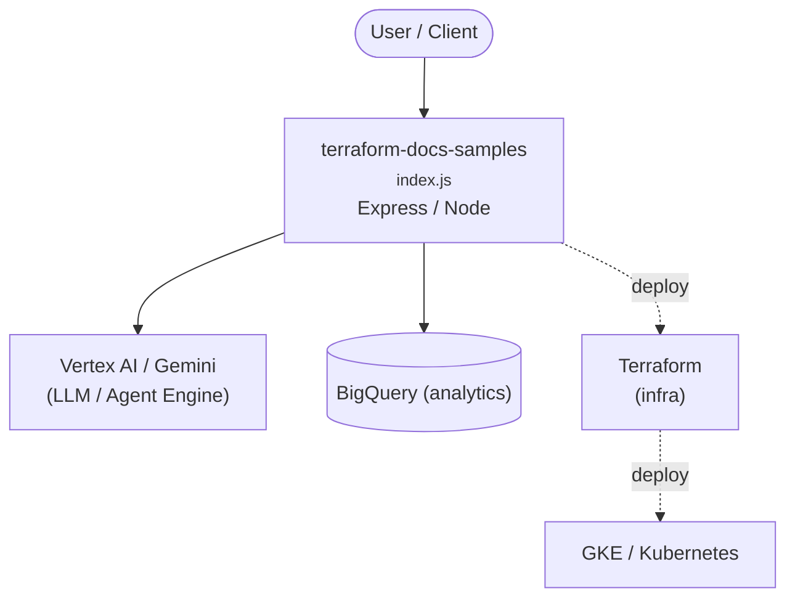

# Context Map — `terraform-docs-samples`

> Auto-generated architecture & deployment context map. Summarizes the core application, container/cloud footprint, and database connections. Regenerate after significant structural changes.

**Repo:** `avnit/terraform-docs-samples` · **Fork** · Public · Primary language: HCL · Default branch: `main` · Files: 656

**Description:** Terraform samples intended for inclusion in cloud.google.com

## 1. Core application

terraform-docs-samples

- **Frameworks / runtime:** Express / Node
- **Entry points:** `functions/basic/functions/hello-world/index.js`, `functions/basic_audit_logs/function-source/index.js`, `functions/basic_gcs/function-source/index.js`, `functions/pubsub/function-source/index.js`
- **Listens on port(s):** 80, 443, 3306, 8000, 8080, 1433

## 2. Containers & cloud applications

**Infrastructure as Code:**
- `application_integration/create_auth_config/main.tf`
- `application_integration/provision_region/main.tf`
- `backupdr/backup_plan/main.tf`
- `backupdr/backup_plan_association/main.tf`
- `backupdr/backup_vault/main.tf`
- `bigquery/biglake/biglake_metastore_create_table/main.tf`
- `bigquery/biglake/bigquery_create_object_table/main.tf`
- `bigquery/biglake/bigquery_create_partitioned_biglake_table/main.tf`
- `bigquery/biglake/bigquery_create_unpartitioned_biglake_table/main.tf`
- `bigquery/bigquery_authorized_view_tutorial/main.tf`

**Detected cloud platforms / services:** Vertex AI / Gemini (GCP), GKE / Kubernetes, BigQuery, Terraform

## 3. Database connections

**Datastores in use:** BigQuery (analytics)

**Referenced in:**
- `bigquery/biglake/biglake_metastore_create_table/main.tf`
- `bigquery/biglake/bigquery_create_object_table/main.tf`
- `bigquery/biglake/bigquery_create_partitioned_biglake_table/main.tf`
- `bigquery/biglake/bigquery_create_unpartitioned_biglake_table/main.tf`
- `bigquery/bigquery_authorized_view_tutorial/main.tf`

## 4. Architecture diagram

## 5. Security posture

- **Static scan findings:** 1 critical, 16 high, 14 medium

| Severity | Rule | File:Line |
|---|---|---|
| critical | private-key-block | `application_integration/create_auth_config/main.tf:66` |
| high | generic-secret-assign | `application_integration/create_auth_config/main.tf:126` |
| high | generic-secret-assign | `application_integration/create_auth_config/main.tf:145` |
| high | tf-public-bucket | `certificate_manager/google_managed_lb_auth/main.tf:131` |
| high | tf-public-bucket | `functions/basic/main.tf:75` |
| high | tf-public-bucket | `lb/external_cdn_lb_with_backend_bucket/main.tf:47` |
| high | tf-public-bucket | `lb/external_http_lb_bucket_backend/main.tf:68` |
| high | tf-public-bucket | `lb/external_http_lb_bucket_backend/main.tf:74` |

---
_Generated by repo context-mapping pass on 2026-08-13._